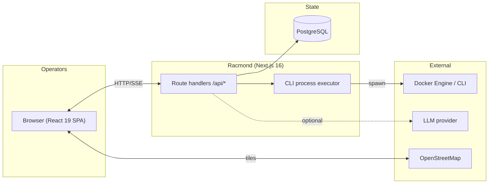
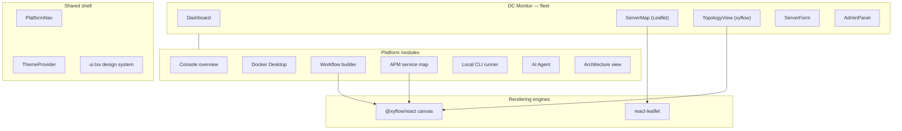
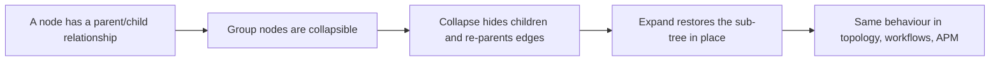
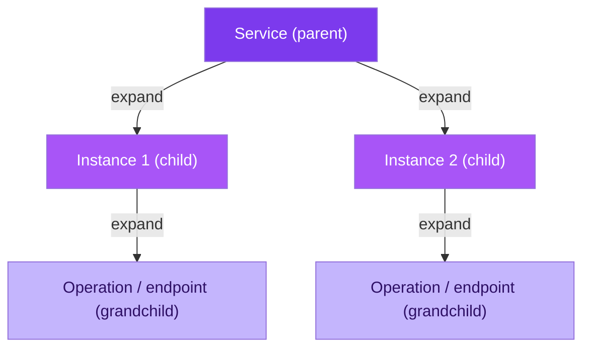
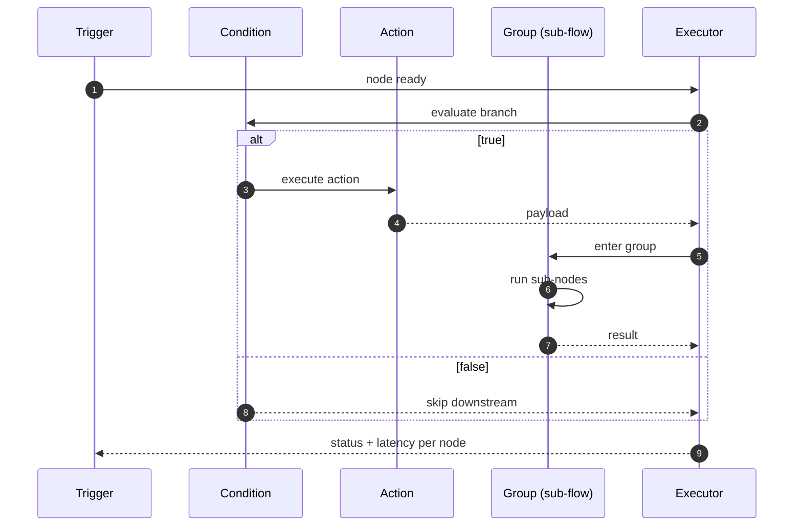
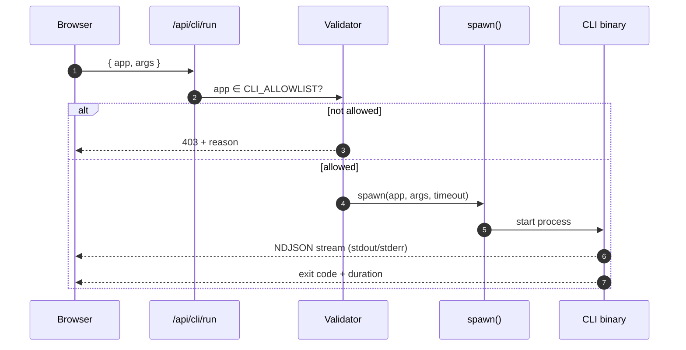
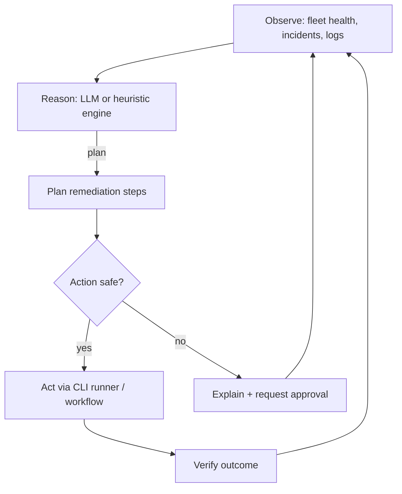
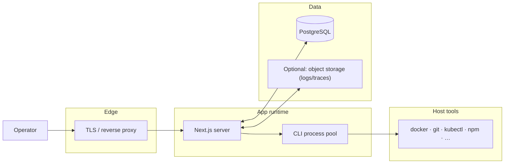

# Racmond — Architecture

This document expands on the high-level architecture in the [README](../README.md)
with module-level detail. Every diagram is a mermaid diagram and is also rendered
live in the app at **`/architecture`**.

---

## 1. System context

---

## 2. Module decomposition

---

## 3. Why one graph engine everywhere

The fleet topology, the workflow builder and the APM service maps all render
through `@xyflow/react`. That gives us drag/zoom/pan, minimap, controls, edge
animation and node selection for free, and keeps the interaction model
consistent:

---

## 4. APM hierarchy

The APM service map is explicitly a set of `@xyflow/react` canvases. Each graph
is one *service domain / environment*. Within a graph, nodes form a strict
three-level parent/child hierarchy:

Edge labels carry **p99 latency**, **error rate** and **throughput** so the map
doubles as a health dashboard.

---

## 5. Workflow execution model

A workflow is a DAG of typed nodes. Groups are collapsible sub-graphs — the same
parent/child convention as APM. Running a workflow walks the DAG in topological
order:

---

## 6. CLI execution flow

The CLI runner is the only module that executes host code. It is deliberately
narrow: a whitelist, a timeout, and a streaming stdout/stderr channel.

---

## 7. AI Agent loop

The agent is an *observe → reason → act* loop. Tool calls are sandboxed through
the same CLI runner, so the agent can only do what the operator has whitelisted.

---

## 8. Deployment & data

