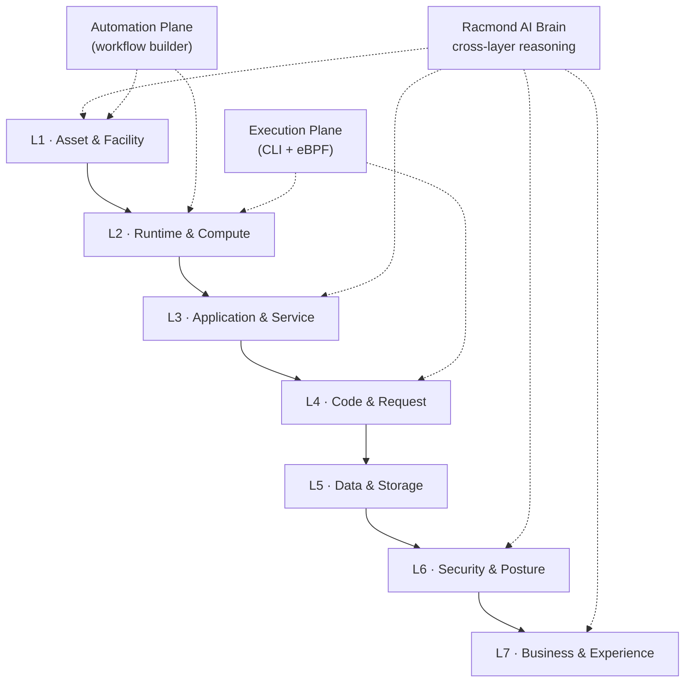
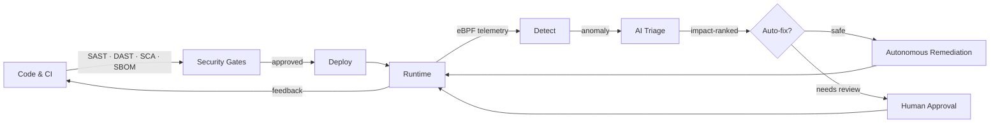

# Racmond — Seven-Layer Observability & DevSecOps AI Roadmap

> **Vision:** turn Racmond from a fleet inventory into a *mission-control plane*
> that observes the estate across seven layers — asset → runtime → application →
> code → data → security → business — and an AI that reasons across **all of
> them at once** to develop, secure and operate software.

This document is the creative roadmap. Every suggestion maps to an existing
Racmond building block (the `@xyflow/react` canvas engine, the local CLI runner,
the workflow builder, the AI agent, the glass design system) so the evolution is
incremental rather than a rebuild.

---

## 1. The Seven-Layer Observability Model

Observability is not one dashboard. It is a stack. Each layer answers a
different question and hands a correlation key to the layer above it.

| Layer | Name | Core question | Today in Racmond | Destination |
| --- | --- | --- | --- | --- |
| **L1** | **Asset & Facility** | *What physical/virtual thing exists, where, and how healthy is it?* | DC Monitor map + topology | Digital twin of every DC, capacity & power/cooling telemetry |
| **L2** | **Runtime & Compute** | *What is running, on what, and how saturated is it?* | Docker Desktop module | Kubernetes, VMs, images, cost & autoscaling events |
| **L3** | **Application & Service** | *How do services call each other, and do we meet SLOs?* | APM service map | Live dependency mesh, SLOs, error budgets, canaries |
| **L4** | **Code & Request** | *What did a single request do, and where did it spend time?* | Trace waterfall | Unified logs, continuous profiles, exceptions, code context |
| **L5** | **Data & Storage** | *Is our data fast, consistent, private and recoverable?* | (none yet) | DB dashboards, slow queries, lineage, PII, backup verify |
| **L6** | **Security & Posture** | *Are we exposed, compliant, and who touched what?* | (none yet) | Vuln mgmt, SBOM, policy-as-code, eBPF runtime security |
| **L7** | **Business & Experience** | *Did the customer succeed, and what did it cost us?* | (none yet) | Synthetics, RUM, business SLOs, revenue impact, AIOps |

Across all layers run three cross-cutting planes:

- **The AI Brain** — a reasoning agent that correlates signals across layers.
- **The Automation Plane** — the workflow builder turned into an event-driven
  control system.
- **The Execution Plane** — the local CLI runner, extended to eBPF sensors and
  safe remediation actions.

---

## 2. Layer-by-layer enhancements

### L1 — Asset & Facility
- **Digital twin of a data centre** — render racks, rows and floor plans in a
  `three.js` (or CSS-3D) canvas, reusing the Leaflet map style.
- **Facility telemetry** — power draw (kW), PUE, temperature, humidity, airflow,
  and battery/UPS state as live graphs on each facility node.
- **Capacity & lifecycle planning** — reserve, allocate and forecast; flag
  end-of-support, warranty expiry and "shadow" assets nobody owns.
- **Spare-parts & maintenance windows** — link a maintenance window to the exact
  assets it touches and the services behind them.
- **Geo-resilience** — map single points of failure across regions and providers.

### L2 — Runtime & Compute
- **Kubernetes view** — namespaces, workloads, nodes, pods and events on a
  second `@xyflow/react` canvas (same engine, new graph).
- **Image supply-chain view** — provenance, digest, base image and CVEs per
  running container; click to jump to L6.
- **Resource heatmaps & saturation** — CPU/mem/IO/GPU saturation with anomaly
  shading; correlate to the owning asset (L1).
- **Cost & tagging hygiene** — cost per org/project/tag, untagged-resource
  alerts, rightsizing suggestions.
- **Autoscaling & chaos events** — HPA/VPA events, and a Chaos-Mesh style
  fault-injection timeline.

### L3 — Application & Service
- **Live service mesh** — a continuously reconciled call graph with SLO badges
  per edge; keep the existing expand/collapse hierarchy.
- **SLOs & error budgets** — per-service objectives, burn-rate alerts and a
  "budget remaining" gauge that the agent can act on.
- **Canary & traffic analytics** — success rate, latency and payload diffs
  between canary and stable.
- **Dependency drift detection** — "this service gained a dependency at 14:02"
  events feeding L6.
- **Version-to-topology mapping** — tag every service node with a deploy version
  and jump to the deploy workflow.

### L4 — Code & Request
- **Unified log explorer** — one stream across services with faceted
  log-source filters (reuse `FilterPanel`); click a log line to open its trace.
- **Trace-to-code** — annotate spans with source file/line and deploy diffs.
- **Continuous profiling** — CPU/memory/wall profiles with flame graphs
  (Pyroscope/Parca-style) tied to a trace.
- **Exception & crash aggregation** — grouped by stack signature, linked to
  the service (L3) and the deploy that introduced it.
- **Correlation IDs everywhere** — trace id → log id → metric → workflow run →
  incident, one pivot.

### L5 — Data & Storage
- **Database dashboards** — per-engine (Postgres/MySQL/Redis/Kafka) latency,
  connections, locks, cache hit ratio.
- **Slow-query analyzer** — top queries, plans, and AI-suggested indexes.
- **Replication & durability** — lag, WAL/LSN, RPO/RTO, backup verification.
- **Data lineage** — a graph from source system to dashboard to customer.
- **Privacy & residency** — PII detection, field-level classification and
  region-of-record enforcement.

### L6 — Security & Posture
- **Vulnerability management** — CVSS-ranked findings, reachability analysis
  ("exposed & reachable" vs "present"), and remediation time-to-fix.
- **SBOM browser** — software bill of materials per image/service, with
  license and provenance.
- **Policy-as-code studio** — author/test OPA-Rego policies, see violations
  mapped onto the topology.
- **Secrets & access** — secret scanning, IAM drift, least-privilege reports,
  just-in-time elevation with approval.
- **Runtime security (eBPF)** — process/network/file telemetry, anomalous-call
  detection, drift from a learned baseline.
- **Compliance state** — SOC 2 / ISO 27001 / HIPAA evidence, continuously
  assessed rather than audited annually.

### L7 — Business & Experience
- **Synthetic checks** — probes from multiple regions hitting critical journeys.
- **Real user monitoring (RUM)** — page load, error rate, conversion funnel.
- **Business SLOs** — "checkout success", "search latency", "order accuracy",
  each mapped to the services (L3) and infrastructure (L1–L2) that back them.
- **Impact & revenue attribution** — when an incident fires, estimate customer
  and revenue impact before you triage.
- **AIOps** — baseline + anomaly detection and cross-layer correlation that
  reduces alert noise into a handful of ranked incidents.

---

## 3. DevSecOps AI

DevSecOps is the feedback loop between *develop*, *secure* and *operate*.
Racmond becomes the plane that closes it.

### Pillars

1. **Secure SDLC in the workflow builder**
   - Security gate nodes: SAST (Semgrep/CodeQL), DAST, secret scan, IaC scan,
     SBOM generation, license gate.
   - Block merge on failing gates; allow policy exceptions with an expiry and
     an approver.
   - Embed security findings as a **DevSecOps graph** on the same canvas as the
     deployment flow.

2. **Supply-chain integrity**
   - Signed, attested artifacts (Sigstore/Cosign); provenance per deploy.
   - Dependency graph with reachable-CVE highlighting.
   - "You shipped a transitive dependency with a known RCE" → jump straight to
     the vulnerable service and the affected versions.

3. **Runtime security & zero trust**
   - eBPF sensors (Tetragon/Falco-style) feeding the L6 signal stream.
   - Service-to-service policy enforcement; unexpected east-west calls flagged.
   - Drift detection against a learned normal-call baseline.

4. **Policy-as-code**
   - Policies written in Rego, versioned, tested in PRs, enforced at deploy and
     runtime.
   - An AI assistant that drafts policies from a plain-language request and
     explains violations.

5. **AI triage & autonomous response**
   - Correlate alerts across all seven layers, rank by business impact,
     propose a ranked remediation plan.
   - Execute safe actions (restart, rollback, scale, failover) only inside
     guardrails, with approval for anything destructive.
   - Every AI action writes an **audit record** with the reasoning that led to it.

6. **Code-to-cloud traceability**
   - commit → build → deploy → runtime → incident, fully linked.
   - "Which code introduced this alert?" answered in one hop.
   - Auto-generated runbooks from incidents, reviewed and stored as knowledge.

---

## 4. Evolving the AI Agent

| Today | Evolved |
| --- | --- |
| Single chat agent + heuristic engine | **Multi-agent system**: Planner, Investigator, Security Reviewer, Executor, Verifier |
| Answers from fleet state | Reason **across all seven layers** and cite the evidence for each claim |
| Manual prompts | **Event-driven**: agent wakes on alert/SLO-burn/deploy/scan and proposes a plan |
| Suggested probes | **Tool use**: query metrics, open traces, run allowlisted CLI, trigger a workflow, patch with approval, roll back |
| No memory | **Knowledge base**: RAG over runbooks, past incidents, run-history and policies |
| One-shot answers | **Human-in-the-loop** approvals + full audit trail + "explain why" panel |
| Diagnose only | **Predict & prevent**: SLO burn-rate prediction, capacity forecasting, risk scoring |

The agent becomes the natural language front-end to the whole platform:
*"Why is checkout slow in eu-west-1?"* → traces the journey from L1 (facility
pressure) → L2 (node saturation) → L3 (service dependency) → L4 (slow span) →
L5 (lock contention) → L7 (revenue impact) and proposes the fix.

---

## 5. Evolving the workflow builder

- **Triggers from any layer** — metric threshold, log pattern, trace anomaly,
  deploy event, compliance drift, synthetic failure.
- **Security gates inside workflows** — sign-off steps, policy checks,
  pre-merge scans.
- **Sub-workflows & versioning** — reusable, versioned, diffable workflow
  definitions persisted server-side (not just `localStorage`).
- **Scheduled & event-driven runs** — cron + webhook + event-bus triggers.
- **CI/CD as workflow** — the release pipeline becomes a first-class template
  with security gates wired in.
- **Simulation & what-if** — dry-run against the current topology before
  executing anything risky.

---

## 6. Platform, data & API evolution

**New data domains** (new Drizzle tables, same pattern as `servers`):
`telemetry_metrics`, `logs`, `traces`, `spans`, `services`, `deployments`,
`incidents`, `vulnerabilities`, `policies`, `synthetics`, `slo_objects`,
`audit_log`, `ai_traces`.

**Ingestion & APIs**
- **OTLP endpoints** (`/api/otlp/...`) for traces, metrics and logs.
- **Metrics backend** (Prometheus/VictoriaMetrics) and **log store**
  (Loki) behind one query API.
- **Webhooks & an event bus** for cross-layer correlation.
- **RBAC + audit log** — who/what/when for every mutating action (human *and* AI).

**Design language**
- One **Command Deck**: a command palette + AI dock that can annotate any panel.
- One **Mission Control** view with a layer switcher (L1–L7).
- Reuse the glassmorphism system and the `@xyflow/react` canvas for every graph
  (mesh, lineage, SBOM, workflow, digital twin).

---

## 7. Phased roadmap

### Phase 0 — Foundations (now → +30 days)
- Unify correlation IDs; add OTLP ingest stubs.
- Extend the agent with cross-layer tools (metrics, traces, CLI).
- Add the L6 vulnerability dashboard fed by a scanner.
- Make workflows server-persisted and event-triggered.
- **KPI:** one-click "why" from alert → span → code.

### Phase 1 — Close the loop (+1–3 months)
- L4 log explorer + continuous profiling.
- L5 data observability (DB dashboards, slow queries, lineage).
- DevSecOps gates in the release workflow; SBOM browser.
- Policy-as-code studio.
- **KPI:** measurable reduction in mean time to detect/resolve.

### Phase 2 — Autonomous (+3–6 months)
- eBPF runtime security; anomaly baselines.
- AI triage + guarded autonomous remediation with approvals.
- Business SLOs + impact attribution.
- Digital twin + capacity forecasting.
- **KPI:** self-resolving incidents with auditable reasoning.

### Phase 3 — Predictive & predictive-cost (+6–12 months)
- Cross-layer predictive failure & SLO-burn forecasting.
- Supply-chain provenance and compliance-as-evidence.
- Multi-tenant federation across organisations/regions.
- **KPI:** prevent incidents before they reach customers.

---

## 8. Quick wins (first two weeks)

1. Add a **L4 log explorer** reusing `FilterPanel` and the glass system.
2. Wire the **agent** to `/api/agent/chat` with tool calls that open traces.
3. Add an **SLO badge** to APM service nodes with burn-rate alerting.
4. Add a **vulnerability dashboard** (L6) as a new module.
5. Turn one workflow into a **CI/CD pipeline template with a security gate**.
6. Add a **Command Deck** palette for fast navigation across the seven layers.
