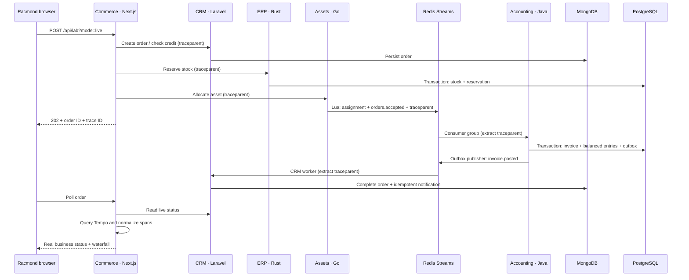

# Racmond rack-to-revenue lab

A local, polyglot integration environment for demonstrating **real distributed traces**, persistent business state and Java/Go runtime telemetry. This is not a production ERP, CRM or accounting product. All customer and order data is synthetic.

## What is implemented

| Service | Language/framework | Persistence | Responsibility |
| --- | --- | --- | --- |
| `racmond` / `commerce` | Next.js 16, TypeScript | PostgreSQL for the original fleet; bounded in-memory demo history | Gateway, order orchestration, trace investigation UI, server-side Tempo queries |
| `crm` | PHP 8.3, Laravel 12 | MongoDB | Credit policy, orders, invoice-event consumer, synthetic notification records |
| `erp` | Rust, Axum, SQLx | PostgreSQL | Transactional, idempotent stock reservation and compensating release before publication |
| `assets` | Go 1.24, net/http | Redis | Atomic asset assignment + `orders.accepted` publication; runtime metrics |
| `accounting` | Java 21, Spring Boot 3.4 | PostgreSQL + Redis Streams | Idempotent invoice/journal/outbox transaction; invoice publication; JVM GC notifications |
| `crm-worker` | Laravel console command | MongoDB + Redis | Consumes `invoice.posted`, completes orders and records notifications |

Supporting services: OpenTelemetry Collector, Tempo, Prometheus and Grafana. No database, trace backend or Collector port is exposed to the host. Only Racmond (`:3000`) and loopback-only Grafana (`127.0.0.1:3001`) are published.

## Requirements and startup

- Docker Engine with Compose v2, roughly 6 GB available RAM and 15 GB disk for images/build caches/volumes.
- Outbound access to Docker Hub, GitHub Container Registry, npm, Packagist, crates.io, Go module proxy and Maven Central during builds.
- Node.js 22 for the optional host-side UI checks; PHP/Java/Go/Rust are built inside containers.

From the repository root:

```bash
cp lab/.env.example lab/.env
# Edit lab/.env. Replace every local-demo password/token.
openssl rand -base64 32                  # use for a secret
printf 'base64:%s\n' "$(openssl rand -base64 32)"  # LARAVEL_APP_KEY
# Set the generated value as LARAVEL_APP_KEY=base64:... in lab/.env.
docker compose -f lab/compose.yaml config --quiet
docker compose -f lab/compose.yaml up --build -d
docker compose -f lab/compose.yaml ps
```

Open `http://localhost:3000/trace-lab`, select **Live stack**, then **Run transaction**. Open `/runtime` and select **Live processes** for measured JVM/Go samples. Grafana is at `http://127.0.0.1:3001` (user `admin`, password from `lab/.env`). The provisioned dashboard is **Racmond · JVM & Go runtime**; use Explore → Tempo to search traces.

The root `.env` is not the lab `.env`. The main UI can run in demo mode without any containers:

```bash
npm ci --legacy-peer-deps
npm run dev
```

### Remote preview note

Container DNS names are used **only by server-side route handlers**. Browser requests stay same-origin. The Compose Grafana port binds to the Docker host's loopback; use an authenticated SSH tunnel when the Docker host is remote. Do not expose internal databases or Grafana anonymously to make a preview work.

## The journey



### Business rules

- Customer `C-100` is synthetic; credit limit is 10,000,000 cents.
- One `RACK-42U` costs 240,000 cents; quantity is 1–10. No tax, currency conversion, payment capture or real notification delivery.
- A journal debits accounts receivable and credits infrastructure revenue by the same amount.
- `order.id` is the idempotency key across services. A replay gets a **new trace ID**, but reuses the business order, stock reservation, asset and invoice.
- Credit rejection stops before ERP. Stock conflict stops before asset allocation.
- `slow-db` executes `pg_sleep(0.85)` in the Java service; it is a deliberate, bounded fault, not a measured production database problem.
- `gc-pressure` creates bounded, short-lived arrays (24 MiB Java, 8 MiB Go). It does not force a collection or allocate without limit.

## Consistency and recovery boundaries

This lab demonstrates specific patterns; it does **not** claim exactly-once delivery or a complete saga engine:

- ERP stock deduction and reservation share a PostgreSQL transaction and a unique order ID.
- Redis Lua commits assignment and publication together. A replay may publish another envelope, but downstream ledger writes remain idempotent.
- Accounting writes invoice, journal and outbox in one transaction. A replay creates a notification outbox row for the new trace but no second journal. Publishing occurs after commit. A crash after publish but before marking the outbox can produce a duplicate event; CRM's notification key is unique.
- Consumers use fixed group/member names and read their pending entries before new entries. This supports a single worker replica recovering after restart; it is not a multi-replica pending-claim implementation.
- If the gateway gets an ambiguous timeout after attempting asset publication, it does **not** automatically release stock: the event might already be in flight. The order is marked for operator reconciliation. Pre-publication failures request compensation.
- There is no automatic dead-letter workflow, multi-region failover, accounting close process or production PII handling. Do not put real business data into this environment.

## Verify the real stack

```bash
bash lab/smoke.sh
# Optional: keep the test orders for the board demonstration.
KEEP_LAB_ORDERS=1 bash lab/smoke.sh

docker compose -f lab/compose.yaml logs --tail=100 otel-collector accounting crm-worker
```

The smoke test checks service health, executes a real order, waits for completion, checks that all five resource service names occur in the same Tempo trace, replays the order, verifies that invoice and stock counts do not change, and checks both runtime endpoints.

Useful SQL checks:

```bash
docker compose -f lab/compose.yaml exec postgres psql -U racmond -d lab_accounting \
  -c 'SELECT * FROM journal_balance ORDER BY id DESC LIMIT 10;'
docker compose -f lab/compose.yaml exec postgres psql -U racmond -d lab_erp \
  -c 'SELECT * FROM inventory; SELECT state,count(*) FROM reservations GROUP BY state;'
docker compose -f lab/compose.yaml exec mongodb mongosh racmond --quiet \
  --eval 'db.orders.find({},{_id:0,id:1,status:1,invoiceId:1}).sort({createdAt:-1}).limit(5)'
```

### Runtime semantics

- Java heap/pools come from `MemoryMXBean` / `MemoryPoolMXBean`; event duration/cause come from GC notifications. Memory before/after in the event table is the sum of reported heap pools.
- Go heap comes from `runtime.MemStats`; Compose sets `OTEL_GO_X_DEPRECATED_RUNTIME_METRICS=false` so the provisioned dashboard uses the current `go.memory.*` / `go.goroutine.*` metric names; goroutines are not OS threads. Recent pause durations come from the 256-entry runtime pause ring. A low-frequency poll can miss events if more than 256 collections occur between samples.
- Go does not expose per-pause before/after heap or a cause in that ring; the UI says **not exposed**, rather than inventing those values.
- `gcTimeMs` is cumulative collector/pause time, not elapsed wall time. The chart shows **deltas between polls**, not individual pauses. JVM and Go measurements are not directly equivalent.
- The browser retains 300 samples per source/service. It is not a historical metrics database; Grafana/Prometheus provide retained telemetry.
- The runtime API is internal and token-protected. Heap dumps, arbitrary MBean writes and forced GC are deliberately absent.

## Configuration

| Variable | Purpose |
| --- | --- |
| `LAB_ENABLED` | `true` enables server-side live orchestration; otherwise only explicit demo mode works. |
| `LAB_INTERNAL_TOKEN` | Shared local service token; sent server-to-server, never returned to the browser. Not user authentication. |
| `LAB_CRM_URL` | Compose: `http://crm:8001/api`. |
| `LAB_ERP_URL`, `LAB_ASSETS_URL`, `LAB_ACCOUNTING_URL` | Internal service base URLs. |
| `LAB_TEMPO_URL` | Internal Tempo query URL, default `http://localhost:3200` for a separately started local stack. |
| `OTEL_EXPORTER_OTLP_ENDPOINT` | Collector base URL. Next.js instrumentation is opt-in when this is set. |
| `OTEL_SERVICE_NAME` | Exact logical service name; defaults to `commerce` in the gateway. |
| `DATABASE_URL` | Original fleet PostgreSQL connection; Compose supplies the lab's main DB. |
| `GOMEMLIMIT` | Go soft memory limit; Compose uses 100 MiB, not a fixed heap ceiling. |

## Troubleshooting

- **Live mode says not configured:** the Next.js process must have `LAB_ENABLED=true` and the internal URLs/token. Changing `lab/.env` does not configure an already-running host-side `npm run dev`; use the Compose `racmond` service or export the variables before starting it.
- **Order pending:** inspect `accounting` and `crm-worker`; confirm Redis credentials and consumer groups. A pending order is not silently converted to a successful demo.
- **Order complete but no waterfall:** Collector/Tempo export is eventually consistent. Allow several seconds, then inspect Collector logs and Tempo readiness. Business completion and trace availability are separate states.
- **No PHP spans:** verify the `opentelemetry` PHP extension, Composer auto-instrumentation packages and `OTEL_PHP_AUTOLOAD_ENABLED=true`.
- **Build downloads fail:** this environment needs package registries beyond GitHub/npm. Run the build on a Docker host with the required access; do not describe an unbuilt image as tested.
- **Port 3000 occupied:** stop the host dev server or change only the host-side Compose port mapping. Keep the container port at 3000.

## Reset and shutdown

```bash
docker compose -f lab/compose.yaml down             # keep persistent volumes
docker compose -f lab/compose.yaml down --volumes   # DESTRUCTIVE: deletes lab data
```

The second command is intentionally not run by the smoke test. Never point this local stack at production databases.
